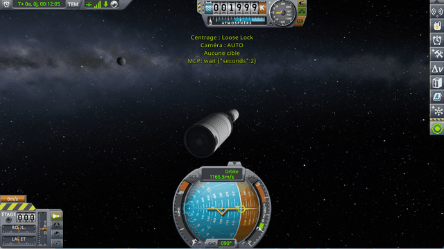

# Robotics Loose Lock Fix

**⚠️ Not finished yet.** This is a new fix, not a finished mod. The code and the conclusions on this page can still change.

A fix for stock KSP 1.12, kept as small as possible: one Harmony prefix and one add-on, in one source file. It is a
mod of its own, built on top of [KSP Community Fixes](https://github.com/KSPModdingLibs/KSPCommunityFixes), the base
most players run. Here is what it fixes:

> **After a time warp, a locked robotic part can stop holding.** A locked piston slides in and out as the vessel
> moves, through its whole range, while its part action window still says it is locked. It takes a time warp at the
> wrong moment: the vessel loading while time is warped.



*Stock KSP 1.12 with KSP Community Fixes, the protocol of [Checking the culprit](#checking-the-culprit): the vessel
loaded during a time warp at 10x, then set spinning with its reaction wheel.*

The motor of a robotic part is what holds it locked, and a time warp switches that motor off without switching it
back on: see [The culprit](#the-culprit). This mod switches it back on when the warp ends.

**How this was made.** The investigation and the code were written with Claude, Anthropic's AI
assistant. Everything here was reviewed and validated by a human — me. I am saying so up front, because
contributions made with an AI deserve a closer look than others, and because some people would rather
stop reading here. That look should be quick: the stock code involved is named and quoted on this page, and the fix
is one source file you can read in a few minutes.

## Why it matters

A locked robotic part is supposed to be the one you can trust: a piston locked at its length, a hinge locked at its
angle, to hold a crane arm, a docking port, a landing frame. Nothing tells the player it no longer holds: the part
action window says it is locked, and so does the saved game.

It takes no unusual move to get there: warping towards a rendezvous, by hand or with an autopilot, until the other
vessel comes within loading range. It loads during the warp, and every robotic part on it starts with its motor off.

A time warp alone does nothing: a vessel already loaded keeps its robotic parts as they are, warp or not.

Whether the part then moves depends on what else holds it. A piston at the root of a crane, with nothing but a docking
port beyond it, slides freely; a piston or hinge that autostruts or struts also hold may stay where it is, and show
nothing until they let go.

Without this mod, unlocking the part brings its motor back: it returns to its target, and can be locked again once it
is there.

## The culprit

A locked robotic part is not a rigid joint. Its `ConfigurableJoint` keeps its free axis, and the lock only sets the
target of the motor's drive, a spring, to the position where the part was locked. The strength of that drive is set
in `OnModifyServo`, which each robotic part overrides, and which returns early when time is warped on rails:

```csharp
// ModuleRoboticServoPiston.OnModifyServo (KSP 1.12); the same in the hinge, the rotation servo and the rotor
if (TimeWarp.CurrentRateIndex > 0 && TimeWarp.WarpMode == TimeWarp.Modes.HIGH)
{
    jointDrive = servoJoint.xDrive;
    jointDrive.positionSpring = 0f;
    jointDrive.positionDamper = 0f;
    jointDrive.maximumForce = 0f;
    servoJoint.xDrive = jointDrive;
    return;
}
```

Nothing calls it again when the warp ends: `BaseServo` reacts neither to the warp nor to its vessel going off rails.
It is only called when a setting of the part changes, and when the part starts, as its vessel loads. A part that went
through it during the warp keeps a drive with no spring and no force: locked, nothing holds it.

The rotor is the exception: locked, it sets its drive again at every physics step (`ModuleRoboticServoRotor.OnFixedUpdate`),
and holds again on its own. Running, it does not.

## Checking the culprit

KSP 1.12.5 with [KSP Community Fixes](https://github.com/KSPModdingLibs/KSPCommunityFixes) 1.41.1 and the Breaking
Ground expansion. Copy [loose-lock-rendezvous.sfs](diag/loose-lock-rendezvous.sfs) into the folder of a sandbox game
and load it. Two vessels are in a high orbit of Kerbin:

- **Loose Lock**, the target: an empty Rockomax X200-32, a large reaction wheel, a probe core and a battery, then a
  3PT piston, locked retracted, and a full FL-T400 at its end. No autostrut anywhere.
- **Chaser**, the active vessel: Jebediah in a Mk1 pod, an FL-T200 and a Terrier. It is 3 km behind Loose Lock, out
  of its loading range, and closes in at 5 m/s on a course that passes it at about 50 m. Loose Lock is its target,
  and it faces retrograde, relative to the target.

Then, by hand:

1. Turn on SAS, in retrograde mode.
2. Warp time at 10x. About a minute later, Loose Lock is about 100 m away: it loaded during the warp.
3. Back to normal time, and cancel the speed relative to Loose Lock with a short burn, at low throttle.
4. Switch to Loose Lock (`]`), and open the part action window of the piston: it says it is locked.
5. Pitch for a second (`S`): the reaction wheel sets the vessel spinning.

- **On stock:** as the vessel spins, the piston slides out to its full extension, and stays there. Its part action
  window still says it is locked.
- **With this mod:** the piston stays retracted. At `Debug` (see [Settings](#settings)), `KSP.log` shows the drive of
  the piston zeroed during the warp, then configured again after it.

**By script.** [run-loose-lock.py](diag/automation/run-loose-lock.py) plays the same steps through
[KSP-Util-MCPServer](https://github.com/lhervier/KSP-Util-MCPServer), and reads what the player reads: the distance
to Loose Lock, the speed above the navball, the part action window of the piston. Python 3 only, nothing to install:
start KSP with KSP-Util-MCPServer, copy [loose-lock-rendezvous.sfs](diag/loose-lock-rendezvous.sfs) into a sandbox
game, then run:

```
python run-loose-lock.py --folder <your sandbox game> --out out
```

It takes about two minutes, takes a screenshot at the end, and prints a list of checks, each PASS or FAIL, then exits
with 0 when all pass, 1 otherwise. The check marked (fix) is what this mod promises: it fails without it. With it:

```
PASS Loose Lock is not loaded when the save is
PASS Loose Lock loads during the warp
PASS the part action window of the piston says it is locked
PASS the part action window says it is locked all along
PASS (fix) the piston stays retracted while the vessel spins (0.00 m at most)
5 of 5 checks passed
```

## The fix

One prefix and one add-on, with their switch in [Settings](#settings), on by default. Nothing is saved; removing the
mod gives the stock behaviour back at once.

- **`restoreDriveAfterWarp`.** A prefix on the `OnModifyServo` override of the piston, the hinge, the rotation servo
  and the rotor (`ModuleRoboticServoPiston`, `ModuleRoboticServoHinge`, `ModuleRoboticRotationServo`,
  `ModuleRoboticServoRotor`) notes the part when it runs during on-rails warp, with the stock code's own test. In
  flight, an add-on checks every frame whether such a warp is still on; once it is over, it calls
  `BaseServo.ModifyServo` on each part noted, as a change in its part action window would. The stock code then sets
  the drive from the part's settings, locked or not, motor engaged or not.

During the warp, nothing changes: the drive stays at zero, as on stock. The vessel is still on rails when the drive is
set again, and comes off rails with it. A part destroyed or unloaded during the warp is skipped. If one of the stock
methods is missing, nothing is patched, with an error in `KSP.log`.

**Why not remove the stock branch.** Its reason is not known: on rails, the parts do not move anyway. The mod keeps it
during the warp and only undoes it afterwards.

**Why check every frame rather than wait for the warp event.** The add-on makes the same test as the stock code,
whatever the order in which the game updates the warp rate and fires its event. When no part was noted, it costs one
test per frame.

## Work in progress

What a player would see if this mod broke something, or what it should fix but was not checked yet, and how to try
it by hand, with the mod and without:

- **A hinge**, **a rotation servo** and **a running rotor**, on a vessel that loads during a warp: after it, the hinge
  and the servo should hold their angle, and the rotor spin at its torque, with the mod.
- **A robotic part moving when its vessel loads during a warp**: with the mod, it should go on to its target.
- **A robotic part that runs out of electric charge during a warp**, and **a robotic part driven by a KAL-1000
  controller during a warp**: after the warp, it should hold, with the mod.
- **Physics warp** (2x to 4x) should change nothing, with the mod or without: the stock branch only applies on rails.

## Install

Copy the `GameData\KSPFixRoboticsLooseLock` folder into the `GameData` folder of KSP. It needs
[Harmony](https://github.com/KSPModdingLibs/HarmonyKSP), as KSP Community Fixes does. It only acts on the robotic
parts of the Breaking Ground expansion.

## Settings

`GameData\KSPFixRoboticsLooseLock\PluginData\settings.cfg` is read once, when KSP starts:

```
// Gives a robotic part its motor drive back as soon as on-rails time warp is over.
restoreDriveAfterWarp = True

// How much the mod writes to KSP.log: Error, Warning, Info or Debug.
logLevel = Info
```

- With `restoreDriveAfterWarp = False`, nothing is patched: a robotic part whose motor was switched off during a warp
  stays that way, as on stock.
- At `Info`, the mod writes one line each time it sets the drive of robotic parts again after a warp. At `Debug`,
  also one line per part when its drive is zeroed during the warp, and one when it is set again.

## Build

Set `KSPDIR` to the folder of a KSP install with Harmony in its `GameData`, then run `build.bat`: it
compiles `GameData\KSPFixRoboticsLooseLock\KSPFixRoboticsLooseLock.dll`. Installing is up to you.

## License

[MIT](LICENSE).
